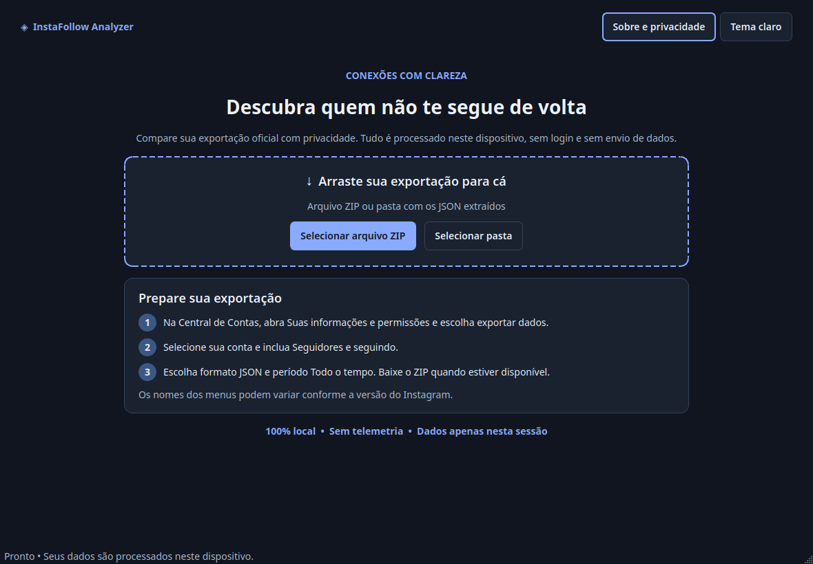
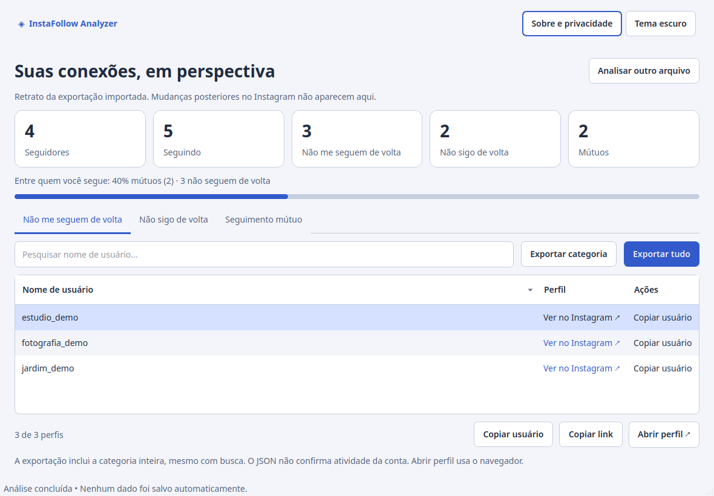

# InstaFollow Analyzer

Aplicativo desktop de código aberto para comparar seguidores e seguindo em
exportações JSON oficiais do Instagram. Feito com Python e PySide6, com
processamento local, sem login e sem telemetria.

**Disponível exclusivamente como código-fonte.** Os executáveis oficiais para
Windows e Linux ainda não foram publicados: a redistribuição das dependências
nativas depende da conclusão da revisão de licenciamento. Para utilizar o
aplicativo, siga as instruções de instalação pelo código-fonte abaixo.

## Funcionalidades

- Importação de ZIP ou pasta extraída, por seleção ou arrastar e soltar.
- Descoberta em subpastas e suporte a `followers_1.json`, `followers_2.json`, etc.
- Dashboard com cinco estatísticas e três categorias de relações.
- Busca sem diferenciar maiúsculas, ordenação, cópia de usuário/link e abertura de perfil.
- Exportação de uma categoria ou de todas para TXT e CSV, com usuário e URL.
- Temas claro e escuro, navegação por teclado e processamento em segundo plano.
- Layout adaptável a partir de 640 × 560, cards que se reorganizam e busca com estado vazio.
- Proporção de mútuos entre quem você segue, com base e contagens explícitas.
- Validação de ambas as listas e limites contra entradas excessivas e ZIP bombs.

Projeto independente, sem vínculo com a Meta/Instagram. Não automatiza seguir
ou deixar de seguir, não faz scraping e não utiliza APIs do Instagram.

## Interface

As capturas em `assets/` são geradas a partir da aplicação real, com dados
fictícios e plataforma Qt offscreen. A aparência das fontes pode variar no desktop.




## Obter os dados

1. No Instagram, abra **Central de Contas → Suas informações e permissões**.
2. Escolha a opção de exportar/baixar informações para o dispositivo.
3. Selecione uma única conta Instagram e **Seguidores e seguindo**.
4. Escolha **JSON** e o período **Todo o tempo**; solicite a exportação.
5. Quando estiver disponível, baixe o ZIP e selecione-o no aplicativo.

Os rótulos dos menus podem mudar. Consulte a
[Central de Ajuda oficial](https://help.instagram.com/181231772500920).
HTML não é suportado. Não envie seu ZIP para este repositório nem para serviços externos.

## Disponibilidade dos executáveis

Não há executáveis oficiais para download público, inclusive em Releases.
O GitHub Actions continua executando testes, builds e verificações de
empacotamento, mas só permite o upload de pacotes e checksums quando o
repositório é **privado**. Nessa condição, candidatos para validação interna
ficam em **Actions → Tests and desktop builds → Artifacts**, por até 14 dias.
Esses candidatos não estão aprovados para redistribuição pública.
O relatório de auditoria ABI do Linux pode continuar disponível sem executáveis.

Antes de mudar a visibilidade do repositório para público, remova os artefatos
antigos que contêm executáveis ou aguarde sua expiração. A condição do workflow
não remove uploads de execuções anteriores. Não reexecute versões antigas do
workflow que ainda permitem esses uploads.

As pendências estão registradas em
[RELEASE_CHECKLIST.md](docs/RELEASE_CHECKLIST.md) e
[FINAL_RELEASE_AUDIT.md](docs/FINAL_RELEASE_AUDIT.md).

## Executar pelo código-fonte

Requer Python **3.12 ou superior**, 64 bits. Execute na raiz do repositório.

Windows (PowerShell; dispensa ativar o ambiente):

```powershell
py -3.12 -m venv .venv
.venv\Scripts\python -m pip install -e ".[dev]"
.venv\Scripts\python -m instafollow_analyzer
```

Linux:

```bash
python3 -m venv .venv
.venv/bin/python -m pip install -e '.[dev]'
.venv/bin/python -m instafollow_analyzer
```

Se `venv` não estiver disponível no Linux, instale o pacote `python3-venv`
correspondente à versão escolhida usando o gerenciador da distribuição.
O download de dependências exige internet apenas na instalação/desenvolvimento.

No Linux, o Qt também depende de bibliotecas gráficas do sistema. Em
Ubuntu/Debian, os pacotes usuais são:

```bash
sudo apt install libegl1 libgl1 libxkbcommon-x11-0 libxcb-cursor0 libxcb-icccm4 \
  libxcb-image0 libxcb-keysyms1 libxcb-render-util0 libxcb-xinerama0 libxcb-xkb1
```

Os nomes variam por distribuição.

## Usar a interface

1. Abra o programa e selecione/arraste o ZIP ou a pasta com os JSON.
2. Aguarde a validação. Listas ausentes, corrompidas ou incompatíveis geram uma
   mensagem em português, sem apresentar uma comparação parcial.
3. Confira os totais e escolha uma das três abas.
4. Pesquise pelo usuário. Clique no cabeçalho para ordenar.
5. Selecione uma linha para copiar usuário/link ou abrir o perfil. A tabela usa
   links compactos; a URL completa permanece disponível na dica de contexto,
   na cópia e na exportação. Duplo clique no nome ou Enter com a tabela em foco
   abre o perfil selecionado. O menu do botão direito oferece as mesmas ações. Abrir o perfil acessa o Instagram
   usando o navegador padrão e a sessão que estiver aberta nele.
6. Exporte a categoria completa ou todas as categorias. A busca não limita
   a exportação; o arquivo inclui a categoria de cada relação.
7. Use **Analisar outro arquivo** para remover o resultado da sessão.

O tema e os dados não são persistidos. Conteúdo copiado permanece na área de
transferência do sistema, sujeito ao histórico do próprio sistema operacional.

## Estrutura e arquitetura

```text
src/instafollow_analyzer/
  main.py, __main__.py      Entrada gráfica
  core/
    models.py              Tipos imutáveis e erros de domínio
    parser.py              Descoberta, validação e leitura limitada
    analyzer.py            Diferença e interseção de conjuntos
    exporter.py            TXT/CSV com substituição atômica
  ui/
    main_window.py         Navegação e tarefas QThread
    home_page.py           Importação e instruções
    results_page.py        Dashboard e modelo de tabela
    theme.py               Paletas e estilos Qt
 tests/                    Fixtures fictícias, domínio e integração Qt
 scripts/                  Entrada de build, pacote e capturas
 .github/workflows/        Testes e builds nativos Windows/Linux
 InstaFollowAnalyzer.spec  PyInstaller onedir
 THIRD_PARTY_NOTICES.md    Licenças e obrigações de distribuição
```

O domínio não importa Qt. Comparações usam `set`/`frozenset`. A tabela usa
modelo/proxy Qt, sem criar um widget para cada perfil. Leitura e exportação
rodam fora da thread da interface. Arquivos são lidos sem extrair o ZIP;
exportações usam arquivo temporário no destino e substituição atômica.

## Testes e qualidade

No ambiente virtual:

```bash
python -m pytest -q
python -m ruff check src tests scripts
python -m ruff format --check src tests scripts
```

Use `.venv/bin/python` no Linux ou `.venv\Scripts\python` no Windows se não ativou
o ambiente. Os testes Qt usam `QT_QPA_PLATFORM=offscreen`, sem abrir o navegador.
Dados de teste são inteiramente fictícios. Veja `docs/VALIDATION.md` para o
registro da validação local e seus limites.

## Gerar distribuições

Para o primeiro envio ao GitHub, revisão de staging e análise dos resultados do
CI, siga [FIRST_CI_RUN.md](docs/FIRST_CI_RUN.md).

Gere **no próprio sistema de destino**, usando o ambiente virtual com `.[dev]`.
O Python escolhido precisa disponibilizar sua biblioteca compartilhada para o
PyInstaller. Se aparecer `Python shared library was not found`, use uma instalação
com essa biblioteca ou instale o pacote `libpython3.X` correspondente no Linux.
Essa exigência é para gerar o pacote; não afeta a execução pelo código-fonte.

Com o ambiente adequado:

```bash
python -m pip install -c requirements-build.txt setuptools
python -m pip install --no-build-isolation -c requirements-build.txt -e ".[dev]"
python -m PyInstaller --clean --noconfirm InstaFollowAnalyzer.spec
python scripts/package.py
python scripts/check_bundle.py --archive
```

No Linux, use Ubuntu 22.04 para gerar a distribuição e instale também `binutils`.
`python scripts/audit_linux.py` produz `build/linux-abi.json` e falha se qualquer
ELF exigir glibc acima de 2.35 ou um requisito GLIBC não classificado. O empacotador
também executa essa checagem antes de preparar o arquivo final. Trocar/remover
bibliotecas isoladamente ou alterar a glibc do host não resolve o build auditado.

O comando PyInstaller cria `dist/InstaFollowAnalyzer/`. O empacotador acrescenta
avisos/licenças, fontes upstream de Qt/PySide/Python e fontes do aplicativo, manifesto
de versões e produz `dist/InstaFollowAnalyzer-0.1.0-<sistema>-x86_64.zip` (Windows) ou
`.tar.gz` (Linux), com um arquivo `.sha256` ao lado de cada pacote.
No Linux, valide-o com `sha256sum -c <pacote>.sha256`; no Windows, compare
`Get-FileHash <pacote> -Algorithm SHA256` com o valor no arquivo.
O hash detecta alterações no download, mas não substitui assinatura/autenticidade.
O checker de `--archive` confere esse SHA-256 antes de extrair o arquivo final.
O empacotamento de fontes requer acesso a `download.qt.io` e `www.python.org`.
Falhas nesse passo interrompem a preparação do pacote distribuível.

No Windows, use `.venv\Scripts\python` para todos os comandos; no Linux,
`.venv/bin/python`. A configuração usa **onedir**, sem terminal no Windows e
sem incorporar o módulo Python QtNetwork nem o navegador WebEngine. Bibliotecas
nativas de rede podem acompanhar dependências Qt; a análise não as utiliza.
Não há compilação cruzada.
As fontes upstream incluídas não cobrem todas as bibliotecas nativas nem
comprovam, sozinhas, a correspondência com os binários. Confira os bloqueios
em [FINAL_RELEASE_AUDIT.md](docs/FINAL_RELEASE_AUDIT.md) antes de distribuir.
O workflow está configurado para executar esses passos em Ubuntu 22.04 e Windows Server 2022 x64, com versões de dependências
fixadas em `requirements-build.txt` (não é um lock de todo o sistema).
Ele testa também a extração do arquivo final. O upload de pacotes e checksums
é permitido somente em repositórios privados; testes e builds continuam
executando em repositórios públicos. Esses builds são candidatos para validação
interna enquanto a distribuição não for aprovada. Empacote um build limpo: arquivos extras na pasta do executável
interrompem o empacotamento; cópias de fontes excluem JSON/ZIP, arquivos ocultos
e links simbólicos. Ele não publica releases nem faz commits.

No Windows, a checagem confere PE x64/GUI, runtime, DLLs Qt/MSVC e plugins.
O smoke test usa Qt offscreen e confirma que o processo permanece ativo por três
segundos com PATH isolado. Isso é um teste automatizado de inicialização; não
testa interação gráfica nem substitui Windows 10/11 sem Python instalado.
Veja a auditoria dos pacotes reais em [FINAL_RELEASE_AUDIT.md](docs/FINAL_RELEASE_AUDIT.md).

## Privacidade, segurança e limites

- Não há chamadas de rede, login, APIs, senhas, tokens ou logs de usuários na análise.
- Dados importados ficam em memória; só a exportação solicitada grava resultados.
- Nenhum ZIP é extraído. Caminhos inseguros, links simbólicos, ZIP criptografado
  ou em volumes e ZIP64 são recusados.
- Limites padrão: ZIP de até 4 GiB; 50.000 entradas; diretório central de 8 MiB;
  JSON de até 32 MiB por arquivo e 128 MiB no total; razão de compressão até 250:1.
  Outros conteúdos do ZIP não são descompactados.
- Listas vazias `[]` são válidas; arquivos de zero bytes não são JSON válidos.
- O parser aceita listas e wrappers `relationships_followers`/`relationships_following`.
  Prioriza `string_list_data.value`, admite URL oficial de perfil como alternativa
  e `title` para seguindo. Estruturas desconhecidas não são ignoradas.
- As listas relevantes devem estar na mesma subpasta. Exportações de várias contas
  ou listas sobrepostas são recusadas. Partes numeradas precisam começar em 1 e
  ser contíguas. A ausência da última parte não pode ser detectada sem manifesto.
- Identificadores válidos com prefixo `_deleted_` permanecem nos totais,
  categorias e exportações. Um aviso e dicas de contexto explicam sua presença.
  O prefixo, sozinho, não confirma conta excluída, desativada ou ativa; não há
  consulta externa para verificar isso. O parser conserva suas validações de
  formato: um identificador incompatível gera erro, nunca remoção silenciosa.
- A aplicação não consegue provar que a Meta exportou todas as relações: o
  usuário deve escolher todo o período e a conta correta. Resultados refletem o
  conteúdo do arquivo, não o estado atual da conta.
- Memória cresce com o tamanho dos JSON. Não há cancelamento no meio da análise;
  para fechar, aguarde a operação em andamento terminar.
- Não há instalador, AppImage ou assinatura digital nesta versão. Builds x86_64;
  ARM e sistemas de 32 bits não foram validados.

## Licença e contribuição

Código do projeto sob [MIT](LICENSE). Qt/PySide6 têm obrigações próprias,
registradas em [THIRD_PARTY_NOTICES.md](THIRD_PARTY_NOTICES.md), com referências
à documentação oficial do Qt. Bibliotecas LGPL permanecem substituíveis.

Consulte [CONTRIBUTING.md](CONTRIBUTING.md) para preparar contribuições e
[SECURITY.md](SECURITY.md) para relatar vulnerabilidades. Abra uma issue descrevendo
o problema, faça mudanças pequenas, execute os testes e envie um pull request. Para novos formatos, acrescente uma
fixture **fictícia** que reproduza a estrutura; nunca anexe exportações pessoais.

Tecnologias: Python 3.12+, PySide6/Qt Widgets, biblioteca padrão, pytest,
PyInstaller, Ruff e GitHub Actions.

## Situação da v0.1.0

A preparação não equivale a uma release aprovada. Consulte o checklist e as
pendências verificadas em [docs/RELEASE_CHECKLIST.md](docs/RELEASE_CHECKLIST.md).
Os seis jobs do [CI auditado](https://github.com/TheoEnderson/instafollow-analyzer/actions/runs/38348981710)
passaram, incluindo Windows Server 2022 e Ubuntu 22.04 com Python 3.12/3.14.
Os testes manuais relatados estão registrados na auditoria final. O código-fonte
está disponível, mas **os executáveis oficiais ainda não foram publicados e sua
distribuição pública permanece bloqueada por pendências de licenciamento nativo**,
detalhadas no checklist. As 74 entradas Linux foram identificadas e seus fontes/
patches preparados; continuam bloqueando a aprovação os termos Microsoft e a
correspondência completa das configurações/fontes Qt/PySide. Não há publicação automática.
