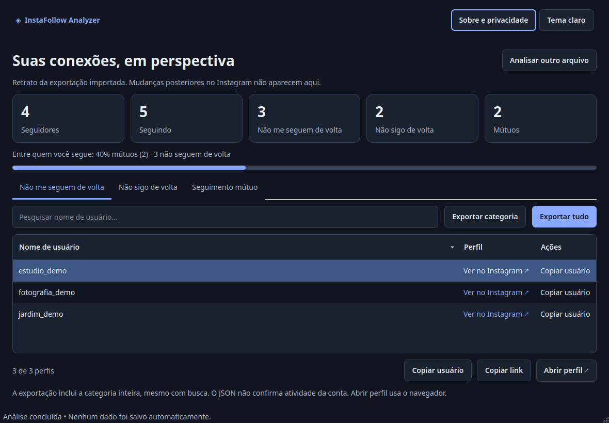

# InstaFollow Analyzer

**Entenda suas conexões no Instagram, com processamento local.**

Aplicação desktop de código aberto para analisar seguidores e seguindo a partir
dos arquivos oficiais de exportação do Instagram. Compare as listas, explore os
resultados e exporte o que precisar, sem fornecer login ou senha ao aplicativo.

[](https://github.com/TheoEnderson/instafollow-analyzer/actions/workflows/desktop.yml)
[](pyproject.toml)
[](LICENSE)

[Funcionalidades](#funcionalidades) · [Interface](#interface) ·
[Instalação](#instalação-pelo-código-fonte) · [Privacidade](#privacidade-e-segurança) ·
[Contribuir](#como-contribuir)

> **Disponível pelo código-fonte.** Os executáveis oficiais para Windows e Linux
> ainda não foram publicados. A redistribuição das dependências nativas está em
> revisão de licenciamento; veja o [checklist de distribuição](docs/RELEASE_CHECKLIST.md).

## Funcionalidades

- **Importação prática:** selecione ou arraste um ZIP oficial ou uma pasta extraída.
  A aplicação localiza os arquivos relevantes em subpastas e aceita listas de
  seguidores divididas em partes, como `followers_1.json` e `followers_2.json`.
- **Visão geral das relações:** cinco cards mostram seguidores, seguindo, quem
  não segue você de volta, quem você não segue de volta e relações mútuas.
  Uma barra apresenta a proporção de mútuos entre os perfis que você segue.
- **Resultados exploráveis:** três abas, busca sem diferenciar maiúsculas,
  ordenação por coluna, cópia de usuário/link e abertura de perfil no navegador.
- **Exportação em TXT e CSV:** salve uma categoria ou todas, com usuário e URL.
- **Interface adaptável:** temas claro e escuro, navegação por teclado e layouts
  que reorganizam cards e controles em janelas pequenas, a partir de 640 × 560.
- **Validação dos arquivos:** mensagens para listas ausentes, dados incompatíveis
  e entradas inseguras, com limites de leitura e descompressão.

## Interface

Capturas da aplicação real, geradas com **dados fictícios**. As fontes e alguns
detalhes de renderização podem variar conforme o sistema.

### Tela inicial

Importação por seleção ou arrastar e soltar, com instruções para obter os dados.


### Dashboard e resultados

Estatísticas, proporção de relações mútuas e tabela de perfis no tema escuro.



<details>
<summary>Ver o dashboard no tema claro</summary>


</details>

## Como funciona

1. **Exporte seus dados** pelo Instagram, em JSON, incluindo seguidores e seguindo.
2. **Importe o ZIP ou a pasta** no aplicativo. A leitura e a comparação acontecem
   no seu dispositivo, sem extrair o ZIP nem enviar os dados a um servidor.
3. **Explore as relações** e, se desejar, exporte os resultados em TXT ou CSV.

| Categoria | O que representa |
| --- | --- |
| Não me seguem de volta | Perfis que você segue e que não aparecem na sua lista de seguidores. |
| Não sigo de volta | Perfis que seguem você e que não aparecem na sua lista de seguindo. |
| Seguimento mútuo | Perfis presentes nas duas listas. |

Os resultados refletem o conteúdo da exportação. O aplicativo não consulta o
estado atual das contas nem automatiza seguir ou deixar de seguir.

## Obter os dados do Instagram

1. Abra **Central de Contas → Suas informações e permissões** no Instagram.
2. Escolha a opção de exportar ou baixar informações para o dispositivo.
3. Selecione **uma única conta** e a categoria **Seguidores e seguindo**.
4. Escolha o formato **JSON** e o período **Todo o tempo**; solicite a exportação.
5. Quando o arquivo estiver disponível, baixe o ZIP e selecione-o no aplicativo.

Os nomes dos menus podem mudar. Consulte a
[Central de Ajuda oficial do Instagram](https://help.instagram.com/181231772500920)
se precisar de orientação. Exportações em HTML não são suportadas.

**Não envie seu ZIP ou seus JSON para este repositório, issues ou serviços externos.**

## Instalação pelo código-fonte

Requer **Python 3.12 ou superior, de 64 bits**, e um ambiente desktop com suporte
às bibliotecas gráficas do Qt. Baixe o código pelo menu **Code → Download ZIP**
ou clone o repositório:

```bash
git clone https://github.com/TheoEnderson/instafollow-analyzer.git
cd instafollow-analyzer
```

Se baixou o ZIP do código, extraia-o e abra o terminal na pasta que contém
`pyproject.toml`. Execute os comandos seguintes nessa pasta. O ZIP do código
não é o ZIP de dados exportado pelo Instagram.

### Windows — PowerShell

Com Python 3.12 instalado e disponível pelo launcher `py`:

```powershell
py -3.12 -m venv .venv
.venv\Scripts\python -m pip install -e .
.venv\Scripts\python -m instafollow_analyzer
```

Se usar outra versão compatível, ajuste `-3.12` para a versão instalada.
Os comandos usam diretamente o Python do ambiente virtual; não é preciso
ativá-lo nem alterar a política de execução do PowerShell.

### Linux

Confira se `python3 --version` informa Python 3.12 ou superior. Se necessário,
use o nome do interpretador compatível instalado, como `python3.12`, no primeiro
comando:

```bash
python3 -m venv .venv
.venv/bin/python -m pip install -e .
.venv/bin/python -m instafollow_analyzer
```

Se `venv` não estiver disponível, instale o pacote `python3-venv` correspondente
à versão escolhida pelo gerenciador da distribuição.

O Qt também depende de bibliotecas gráficas do sistema. Em Ubuntu/Debian,
os pacotes usuais são:

```bash
sudo apt install libegl1 libgl1 libxkbcommon-x11-0 libxcb-cursor0 libxcb-icccm4 \
  libxcb-image0 libxcb-keysyms1 libxcb-render-util0 libxcb-xinerama0 libxcb-xkb1
```

Os nomes variam por distribuição. A instalação das dependências exige internet;
a análise dos arquivos funciona localmente.

## Como utilizar

1. Abra o programa e selecione ou arraste o ZIP ou a pasta com os JSON.
2. Aguarde a validação. Listas ausentes, corrompidas ou incompatíveis geram uma
   mensagem em português, sem apresentar uma comparação parcial.
3. Confira os cinco totais e escolha uma das três abas de resultados.
4. Pesquise um usuário ou clique no cabeçalho da tabela para ordenar.
5. Selecione uma linha para copiar usuário/link ou abrir o perfil. A URL completa
   fica disponível na dica de contexto e na cópia. Um duplo clique no nome ou
   **Enter**, com a tabela em foco, abre o perfil; o menu do botão direito também
   oferece as ações.
6. Exporte a categoria completa ou todas as categorias. **A busca não limita a
   exportação**; o arquivo inclui a categoria de cada relação.
7. Use **Analisar outro arquivo** para remover o resultado da sessão.

Abrir um perfil acessa o Instagram pelo navegador padrão, com a sessão que
estiver aberta nele. O tema e os dados não são persistidos pelo aplicativo.
Conteúdo copiado permanece na área de transferência, sujeito ao histórico do
sistema operacional.

## Tecnologias

| Tecnologia | Uso no projeto |
| --- | --- |
| Python 3.12+ | Leitura dos arquivos, comparação e exportação. |
| PySide6 / Qt Widgets | Interface desktop, tabela e tarefas em segundo plano. |
| pytest | Testes de domínio, segurança, distribuição e integração da interface. |
| Ruff | Análise estática e formatação do código Python. |
| PyInstaller | Builds nativos para validação interna. |
| GitHub Actions | Testes e builds em Windows Server 2022 e Ubuntu 22.04. |

As dependências da aplicação e as ferramentas de desenvolvimento estão em
[pyproject.toml](pyproject.toml). Os builds do CI utilizam as versões fixadas em
[requirements-build.txt](requirements-build.txt), que não é um lock de todo o sistema.

## Privacidade e segurança

- **Processamento local:** a análise não faz chamadas de rede, login, scraping,
  uso de APIs, telemetria ou gravação de logs de usuários.
- **Dados em memória:** os dados importados não são persistidos. A exportação
  grava os resultados apenas no destino escolhido por você.
- **Leitura sem extração:** o ZIP não é extraído. Caminhos inseguros, links
  simbólicos, arquivos criptografados, ZIP em volumes e ZIP64 são recusados.
- **Limites de recursos:** a leitura limita tamanho, quantidade de entradas e
  razão de compressão para reduzir riscos de arquivos excessivos e ZIP bombs.
- **Sem verificação externa de perfis:** nomes com prefixo `_deleted_` não são
  removidos silenciosamente. Quando válidos, permanecem nos totais e nas
  exportações, com aviso na interface. Esse prefixo não comprova que a conta
  esteja excluída, desativada ou ativa.

Para relatar uma vulnerabilidade, siga [SECURITY.md](SECURITY.md). Não anexe
exportações pessoais, credenciais ou tokens aos relatos.

<details>
<summary>Detalhes técnicos da validação de arquivos</summary>

| Limite padrão | Valor |
| --- | --- |
| Tamanho do ZIP | 4 GiB |
| Entradas no ZIP | 50.000 |
| Diretório central do ZIP | 8 MiB |
| Tamanho de cada JSON | 32 MiB |
| Total de JSON lidos | 128 MiB |
| Razão de compressão | 250:1 |

Outros conteúdos do ZIP não são descompactados. Listas vazias (`[]`) são válidas;
arquivos de zero bytes não são JSON válidos.

O parser aceita listas e os wrappers `relationships_followers` e
`relationships_following`. Prioriza `string_list_data.value`, admite URL oficial
de perfil como alternativa e `title` para seguindo. Estruturas desconhecidas ou
identificadores incompatíveis geram erro, em vez de remoção silenciosa.

As listas relevantes devem estar na mesma subpasta. Exportações de várias contas
ou listas sobrepostas são recusadas. Partes numeradas precisam começar em 1 e
ser contíguas. A ausência da última parte não pode ser detectada sem manifesto.

</details>

## Limitações conhecidas

- A aplicação compara a exportação recebida; não consegue provar que a Meta
  exportou todas as relações. Escolha a conta correta e o período completo.
- Somente exportações JSON nos formatos reconhecidos são aceitas. HTML não é suportado.
- Não há detecção automática de contas desativadas nem consulta ao estado atual dos perfis.
- O consumo de memória cresce com o tamanho dos JSON. Não há cancelamento no
  meio da análise; para fechar o aplicativo, aguarde a operação terminar.
- Os executáveis oficiais ainda não estão disponíveis. Não há instalador,
  AppImage ou assinatura digital nesta versão; os builds internos são x86_64.
  ARM e sistemas de 32 bits não foram validados.
- Os testes manuais relatados foram realizados em **Windows 11** e
  **Ubuntu 26.04.1 LTS com Wayland**. Isso não comprova compatibilidade com
  outras versões, distribuições ou sessões gráficas. Ubuntu 22.04 desktop,
  X11 e Windows 10 ainda precisam de validação interativa.
- Os testes do CI usam Qt offscreen e não substituem uso gráfico real. Não foi
  confirmado se Python estava instalado nas máquinas dos testes manuais;
  a execução dos futuros pacotes em máquinas limpas ainda exige confirmação.

## Como contribuir

Consulte [CONTRIBUTING.md](CONTRIBUTING.md) para preparar o ambiente e enviar
contribuições. Abra uma issue com a descrição do problema, mantenha as mudanças
pequenas e explique as verificações realizadas no pull request.

Use apenas **dados fictícios** em testes, capturas e reproduções de problemas.
Nunca anexe ZIP/JSON reais de usuários. Preserve a separação entre domínio e
interface, o processamento local e os avisos de licença de terceiros.

### Desenvolvimento e qualidade

Instale as ferramentas opcionais de desenvolvimento no ambiente virtual:

```powershell
# Windows — PowerShell
.venv\Scripts\python -m pip install -e ".[dev]"
.venv\Scripts\python -m pytest -q
.venv\Scripts\python -m ruff check src tests scripts
.venv\Scripts\python -m ruff format --check src tests scripts
```

```bash
# Linux
.venv/bin/python -m pip install -e '.[dev]'
.venv/bin/python -m pytest -q
.venv/bin/python -m ruff check src tests scripts
.venv/bin/python -m ruff format --check src tests scripts
```

Os testes Qt usam `QT_QPA_PLATFORM=offscreen`, sem abrir o navegador, e dados
inteiramente fictícios. O CI testa Python 3.12 e 3.14 nos dois sistemas.
Consulte [VALIDATION.md](docs/VALIDATION.md) para os registros e limites da validação.

<details>
<summary>Estrutura e arquitetura</summary>

```text
src/instafollow_analyzer/
  main.py, __main__.py      Entrada gráfica
  core/
    models.py              Tipos imutáveis e erros de domínio
    parser.py              Descoberta, validação e leitura limitada
    analyzer.py            Diferença e interseção de conjuntos
    exporter.py            TXT/CSV com substituição atômica
  ui/
    main_window.py         Navegação e tarefas QThread
    home_page.py           Importação e instruções
    results_page.py        Dashboard e modelo de tabela
    theme.py               Paletas e estilos Qt
tests/                     Fixtures fictícias, domínio e integração Qt
scripts/                   Entrada de build, pacote e capturas
.github/workflows/         Testes e builds nativos Windows/Linux
InstaFollowAnalyzer.spec    PyInstaller onedir
THIRD_PARTY_NOTICES.md      Licenças e obrigações de distribuição
```

O domínio não importa Qt. Comparações usam `set`/`frozenset`. A tabela usa
modelo/proxy Qt, sem criar um widget para cada perfil. Leitura e exportação
rodam fora da thread da interface. Exportações usam arquivo temporário no
destino e substituição atômica.

As capturas são geradas por [scripts/screenshots.py](scripts/screenshots.py),
com dados fictícios e plataforma Qt offscreen.

</details>

<details>
<summary>Builds e distribuição — validação interna</summary>

**Gerar um pacote não autoriza sua redistribuição pública.** As pendências de
licenciamento nativo permanecem registradas em
[RELEASE_CHECKLIST.md](docs/RELEASE_CHECKLIST.md) e
[THIRD_PARTY_NOTICES.md](THIRD_PARTY_NOTICES.md). As 74 entradas Linux da auditoria
foram identificadas e seus fontes/patches preparados; continuam pendentes os
termos Microsoft e a correspondência completa das configurações/fontes Qt/PySide.

Gere **no próprio sistema de destino**, usando o ambiente virtual com `.[dev]`.
Não há compilação cruzada. O Python precisa disponibilizar sua biblioteca
compartilhada para o PyInstaller. Se aparecer `Python shared library was not found`,
use uma instalação com essa biblioteca ou o pacote `libpython3.X` correspondente
no Linux. Isso é necessário para o build, não para executar pelo código-fonte.

Com o ambiente adequado e ativado:

```bash
python -m pip install -c requirements-build.txt setuptools
python -m pip install --no-build-isolation -c requirements-build.txt -e ".[dev]"
python -m PyInstaller --clean --noconfirm InstaFollowAnalyzer.spec
python scripts/package.py
python scripts/check_bundle.py --archive
```

Sem ativar o ambiente, substitua `python` por `.venv\Scripts\python` no Windows
ou `.venv/bin/python` no Linux em todos os comandos.

No Linux, gere em **Ubuntu 22.04** e instale também `binutils`.
`python scripts/audit_linux.py` produz `build/linux-abi.json` e falha se qualquer
ELF exigir glibc acima de 2.35 ou um requisito GLIBC não classificado. O empacotador
repete a auditoria. Trocar bibliotecas isoladas ou alterar a glibc do host não
resolve a compatibilidade do pacote auditado.

A auditoria do pacote real do CI examinou 194 arquivos ELF, com requisito máximo
**GLIBC 2.35**. Essa baseline não comprova execução gráfica em todas as distribuições
compatíveis. Sistemas musl, como Alpine, não são alvos validados.
O histórico da investigação está em [DISTRIBUTION_AUDIT.md](docs/DISTRIBUTION_AUDIT.md).

O PyInstaller cria `dist/InstaFollowAnalyzer/`. O empacotador acrescenta avisos,
licenças, fontes upstream de Qt/PySide/Python, fontes do aplicativo e manifesto
de versões. Produz `dist/InstaFollowAnalyzer-0.1.0-<sistema>-x86_64.zip` no Windows
ou `.tar.gz` no Linux, com um arquivo `.sha256` ao lado de cada pacote.

No Linux, valide com `sha256sum -c <pacote>.sha256`; no Windows, compare
`Get-FileHash <pacote> -Algorithm SHA256` com o arquivo de checksum.
O hash detecta alterações, mas não substitui assinatura ou autenticidade.
O checker de `--archive` verifica o SHA-256 antes de extrair o pacote final.
O empacotamento de fontes requer acesso a `download.qt.io` e `www.python.org`;
falhas interrompem a preparação.

Use um build limpo: arquivos extras na pasta do executável interrompem o
empacotamento. As cópias de fontes excluem JSON/ZIP, arquivos ocultos e links
simbólicos. Preserve a pasta `_internal` ao lado do executável. No Linux,
preserve também as permissões de execução. Os pacotes incluem o runtime Python;
a inicialização offscreen com PATH isolado não comprova, sozinha, execução
interativa em uma máquina sem Python instalado.

A configuração é **onedir**, sem terminal no Windows, sem incorporar o módulo
Python QtNetwork nem o navegador WebEngine. Bibliotecas nativas de rede podem
acompanhar dependências Qt; a análise não as utiliza. Bibliotecas compartilhadas
ficam separadas do executável, permitindo substituição por versões de ABI
compatível; isso, isoladamente, não comprova conformidade LGPL. Fontes upstream
também não bastam para comprovar correspondência com todos os binários distribuídos.

O workflow usa **Ubuntu 22.04 e Windows Server 2022 x64**, com Python 3.12 para
builds. Testes, builds e auditorias continuam ativos no repositório público,
mas o upload de pacotes e checksums é permitido **somente em repositórios privados**,
com retenção de 14 dias. O relatório ABI Linux pode ser enviado sem executáveis.
Não há publicação automática de releases. A condição não remove artefatos antigos;
não reexecute versões antigas do workflow que permitiam uploads públicos.

No Windows, o checker confere PE x64/GUI, runtime, DLLs Qt/MSVC e plugins.
O smoke test usa Qt offscreen e verifica se o processo permanece ativo por três
segundos com PATH isolado, inclusive após extrair o arquivo final. Não valida
interação gráfica nem substitui testes em Windows 10/11 sem Python instalado.

O [CI auditado](https://github.com/TheoEnderson/instafollow-analyzer/actions/runs/38348981710)
teve seis jobs aprovados. A orientação da primeira execução permanece em
[FIRST_CI_RUN.md](docs/FIRST_CI_RUN.md), como referência técnica.

</details>

## Licença e avisos legais

O código original do projeto é disponibilizado sob a [licença MIT](LICENSE).
Qt/PySide6 e outras dependências têm licenças e obrigações próprias; consulte
[THIRD_PARTY_NOTICES.md](THIRD_PARTY_NOTICES.md). A licença MIT do projeto não
substitui os termos das bibliotecas de terceiros nem autoriza, por si só,
a redistribuição dos executáveis.

**Projeto independente, sem vínculo oficial com Instagram ou Meta.** Não
utiliza APIs do Instagram, não faz scraping e não automatiza ações em contas.
